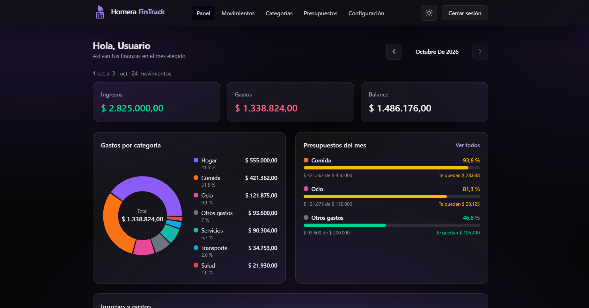
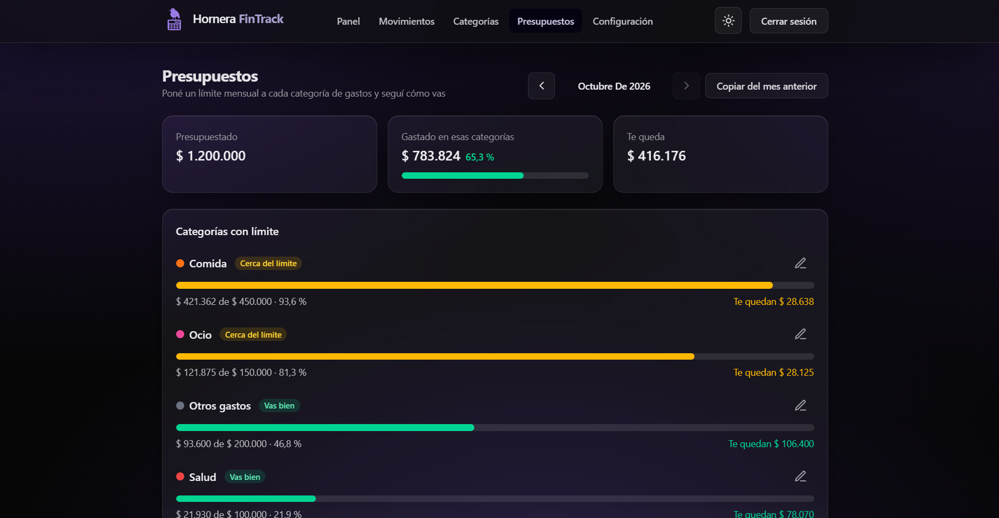
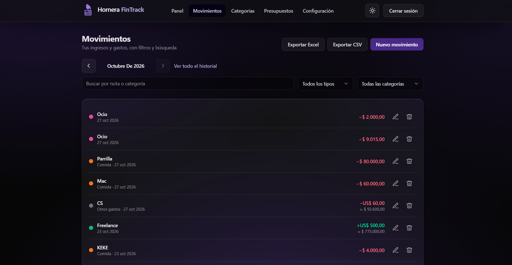

# Hornera FinTrack

Aplicación web de finanzas personales: registrá ingresos y gastos en pesos y dólares, organizalos por categorías, fijá un presupuesto mensual por categoría y mirá hacia dónde va tu dinero.

Proyecto de portfolio fullstack pensado para Argentina: convierte dólares a pesos con la cotización de dolarapi.com (oficial, blue, MEP, etc.) y está todo en español rioplatense.

CAPTURAS:





## Demo

🔗 **https://hornera-fin-track.vercel.app**

Usuario de prueba: `demo@fintrack.dev` / `Demo1234`

> La API está en un plan gratuito: si nadie la usó en un rato, la primera carga puede tardar hasta un minuto en despertar.

## Qué hace

- **Movimientos** en ARS o USD, con filtros, paginación y exportación a CSV y Excel.
- **Categorías** propias, con color.
- **Presupuestos** mensuales por categoría, con barras de progreso y un aviso al cargar un gasto que supera el límite.
- **Panel** con el resumen del mes, gastos por categoría y evolución mensual.
- **Cuenta completa:** registro, recuperación de contraseña por correo, edición de datos y borrado de la cuenta.
- **Personalización:** modo claro y oscuro, y color de acento a elección.

## Tecnologías

React 19 · Vite · Tailwind CSS 4 · Node.js 22 · Express 5 · PostgreSQL · Prisma 6 · Zod · TanStack Query · Vitest · Supertest · pnpm workspaces · GitHub Actions

## Probarlo en tu computadora

Necesitás Node.js 22, pnpm 10 y Docker.

```bash
pnpm install
cp apps/api/.env.example apps/api/.env   # y cambiá JWT_ACCESS_SECRET
pnpm db:up && pnpm db:migrate && pnpm db:seed
pnpm dev:api                             # en una terminal
pnpm dev:web                             # en otra: http://localhost:5173
```

## Más información

La [documentación técnica](docs/DETALLES.md) explica las variables de entorno, la API, los tests, la estructura del proyecto, cómo funciona la autenticación y las decisiones de diseño.
